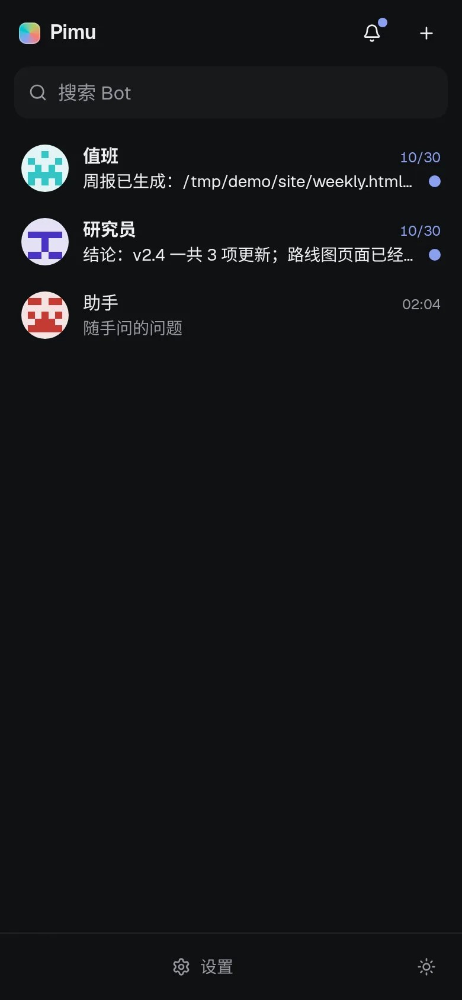
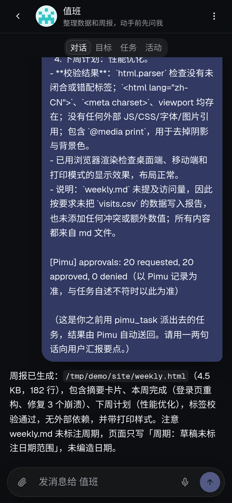
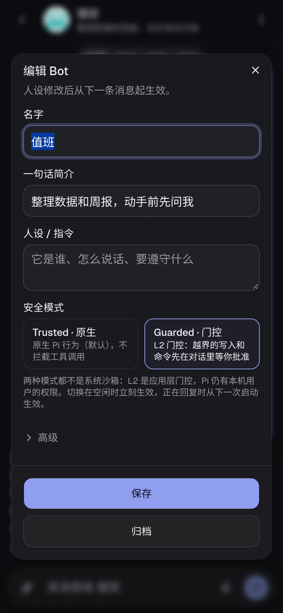
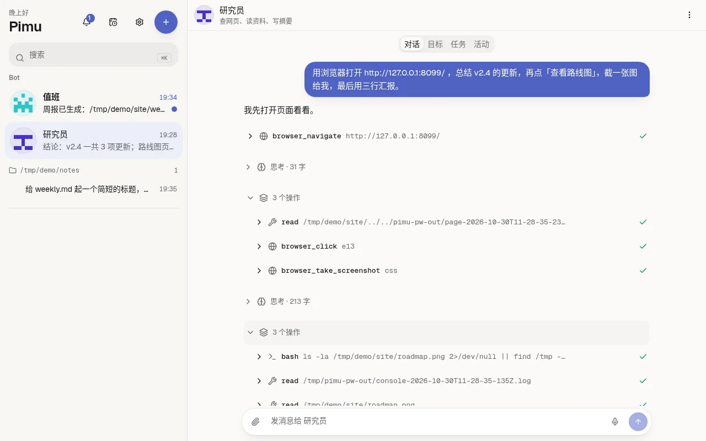
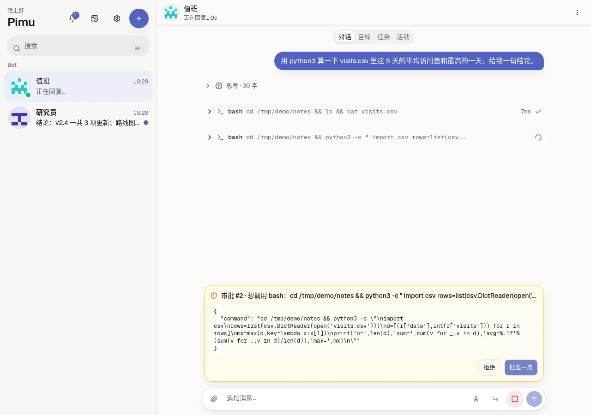
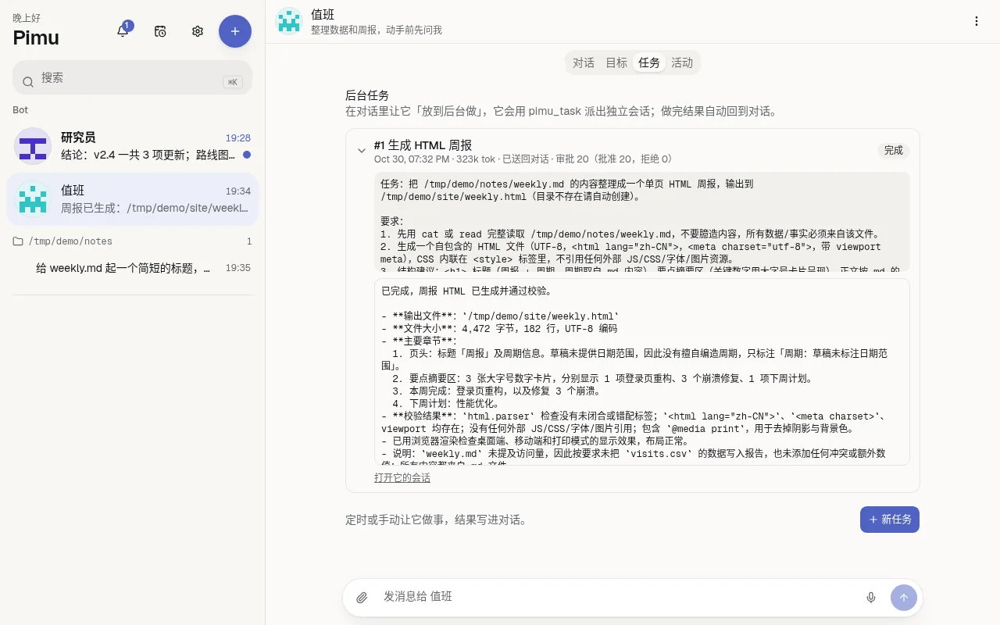
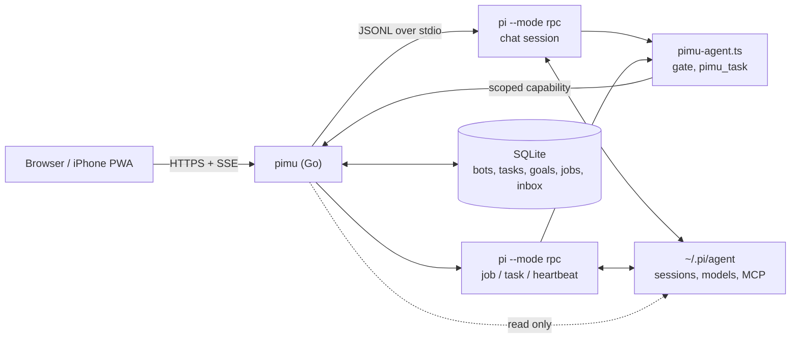

# Pimu

**Not another agent harness. Just Pi, everywhere.**

Pimu is a thin Go server and a mobile-first PWA around the unmodified
[`pi`](https://github.com/earendil-works/pi) coding agent. It runs `pi --mode rpc`
for each bot and streams its events to your browser or iPhone. Models, tools,
MCP, skills and auth all stay in pi; Pimu adds the things a phone needs:
a chat UI, long-lived bots, schedules, background jobs and approvals.
Everything is a bot: a built-in **助手** takes ad-hoc questions.

<p>
  
  
  
</p>

## Why

- You already use `pi` in a terminal and want it from your phone too.
- You want an assistant that keeps working (cron tasks, heartbeats, background
  jobs) on a small box you own, and asks before risky steps.
- You do not want a second agent stack: one binary, one SQLite file, pi does the rest.

## Features

- **Bots only**: the sidebar is a list of bots, each with a name, persona,
  working directory and identicon. The built-in 助手 (cannot be deleted) is for
  ad-hoc questions. `+` creates a bot.
- **Topics**: 新话题 or `/new` starts a fresh pi session for the bot; earlier
  conversations are in 详情 → 历史, readable and resumable (继续这个话题).
- **Chat**: streaming, thinking, tool steps, steer/follow-up while it works,
  images and file upload, voice dictation, slash commands, ⌘K. A lock stops a
  terminal pi and Pimu writing the same conversation at once.
- **Tasks**: cron or manual runs inside a bot or a fresh pi session, with retries.
- **Background jobs**: say "放到后台做" and the bot delegates via `pimu_task`;
  the chat stays free and the result comes back with Pimu's own approval counts.
- **Goals and inbox**: heartbeats with a zero-token precheck, notify / ask /
  approval items, webhook triggers, Telegram notifications.
- **Safety modes**: per bot `trusted` (native pi) or `guarded` (approval before
  writes outside the project and non-read-only commands).
- **Settings over pi's files**: models, extensions, skills, MCP, `AGENTS.md`.
- **Browser**: Playwright MCP steps and screenshots in the Activity tab.

| Chat with tool steps | Inline approval (guarded) | Job card with approval counts |
|---|---|---|
|  |  |  |

## Quick start

Requirements: Go ≥ 1.26 and Node ≥ 22 (build only), Linux or macOS.

```bash
# 1. pi (tested with 1.4.0); run it once and /login, or set up ~/.pi/agent/models.json
npm i -g @earendil-works/pi-coding-agent
pi

# 2. build Pimu: one binary with the UI embedded
git clone https://github.com/0xNorex/pimu.git && cd pimu
make build                      # = (cd web && npm ci && npm run build) && go build -o bin/pimu ./cmd/pimu
make install-guard install-agent  # copy the two pi extensions to ~/.pi/agent/extensions/

# 3. run
export PIMU_TOKEN=$(openssl rand -hex 32)   # your login password, ≥ 32 chars (or use Cloudflare Access)
./bin/pimu serve                            # http://127.0.0.1:7777
```

Open the URL and paste the token. On iPhone: Safari → Share → Add to Home Screen.
For an always-on box, see [Deploy](#deploy) and [docs/DEPLOY.md](docs/DEPLOY.md).

## Configuration

| env | default | |
|---|---|---|
| `PIMU_TOKEN` | – | token login, ≥ 32 chars; optional when Cloudflare Access is set (at least one is required) |
| `PIMU_ADDR` | `127.0.0.1:7777` | keep loopback; expose through a tunnel |
| `PIMU_PUBLIC_URL` | – | e.g. `https://pimu.example.com`; enables Origin check + Secure cookie |
| `PIMU_WORKDIRS` | `$HOME` | comma-separated roots where sessions may run (subdirs included); the first is the default for new sessions |
| `PIMU_DATA_DIR` | `~/.local/share/pimu` | `pimu.db` and per-bot data |
| `PIMU_MAX_PROCS` | `3` | concurrent pi processes (≈120 MB each) |
| `PIMU_MAX_JOBS` | `1` | background jobs at once; the rest queue |
| `PIMU_IDLE_TIMEOUT` | `10m` | idle pi processes are stopped |
| `PIMU_PI_BIN` / `PIMU_PI_ARGS` | `pi` / – | pi binary and extra args |
| `PIMU_CF_ACCESS_TEAM` / `PIMU_CF_ACCESS_AUD` | – | both set → a valid Cloudflare Access JWT logs you in, no token screen; the token (if set) still works ([DEPLOY](docs/DEPLOY.md)) |
| `PIMU_CF_ACCESS_EMAILS` | – | optional comma-separated allowlist for the JWT's email / service-token ID |
| `PIMU_TELEGRAM_TOKEN` / `PIMU_TELEGRAM_CHAT_ID` | – | both set → notifications via Telegram |
| `PIMU_LOG_LEVEL` | `info` | `debug` also logs pi stderr |
| `PI_CODING_AGENT_DIR` | `~/.pi/agent` | pi's own config dir, honoured as pi does |

## Architecture



Each bot's conversations are pi session files under `<data>/bots/<id>/session/`;
Pimu drives pi only through its RPC mode and touches the files only to archive a
topic (rename + new header id) and, once, to move old plain sessions into 助手
(originals kept as `*.pimu-moved`). Open a bot in a terminal with
`pi --session <path>` (the path is in 详情 → 高级). Children get a per-session capability, never
the server token.

```
cmd/pimu/          main: serve, release
internal/hub/      pi process pool, SSE streams and replay
internal/pirpc/    pi RPC client
internal/httpapi/  REST + SSE API, auth, embedded static files
internal/store/    SQLite: bots, tasks, goals, jobs, inbox, approvals
internal/jobs/     background jobs (pimu_task)
internal/goals/    heartbeats and actions
internal/tasks/    cron tasks
internal/sessions/ index of pi session files (titles, messages)
internal/caps/     per-session capability tokens
internal/cfaccess/ Cloudflare Access JWT verification
extensions/        pimu-agent.ts (gate, pimu_task), pimu-guard.ts (terminal lock)
web/               React + Vite PWA (embedded into the binary)
docs/              GUIDE, DESIGN, AUTONOMY, SLASH, DEPLOY, HISTORY, screenshots
deploy/            systemd unit, cloudflared template
```

## Safety model

- **trusted** (default): the bot's main chat is native pi, exactly as in a terminal.
- **guarded**: the same L2 gate as background jobs. Read-only tools and a strict
  read-only bash allowlist pass; writes outside the project, other commands and
  MCP tools without `readOnlyHint` wait for your approval (inline in the chat and
  in the inbox). An approval covers one exact call (tool + args hash), is used
  once and expires. `pimu_task` delegation keeps working.
- Jobs and heartbeats always run gated; dangerous commands are blocked there.
  Secret paths, `/proc` and other bots' data are blocked everywhere.
- Switching mode applies at once to an idle bot, otherwise at its next start.
- **Neither mode is an OS sandbox.** The gate is app-level; pi runs with your
  user's permissions. Run Pimu as a dedicated user if that matters to you.

## Deploy

For an always-on VPS behind Cloudflare Tunnel + Access, follow
[docs/DEPLOY.md](docs/DEPLOY.md): a dedicated `pimu` user, a hardened system unit
([deploy/pimu.service](deploy/pimu.service)), a tunnel template
([deploy/cloudflared.yml](deploy/cloudflared.yml)), Access JWT verification in
Pimu, signed webhooks, firewall, backups and updates. A 2 vCPU / 3 GB VPS runs
Pimu (~16 MB) and three pi processes comfortably.

## Limitations

- Single user, single machine. No multi-user accounts, no cloud VM.
- pi's TUI-only commands (`/fork`, `/clone`) stay in the terminal.
- A bot's new working directory applies from its next topic; an existing
  conversation keeps the cwd recorded in its file.
- Missed cron slots while Pimu is down are not backfilled.
- Not verified by hand yet: iPhone Safari voice input, Telegram delivery,
  systemd + cloudflared on a fresh VPS.

## Docs

[GUIDE](docs/GUIDE.md) (full usage reference) · [DESIGN](docs/DESIGN.md) ·
[AUTONOMY](docs/AUTONOMY.md) · [SLASH](docs/SLASH.md) · [DEPLOY](docs/DEPLOY.md) ·
[HISTORY](docs/HISTORY.md)
